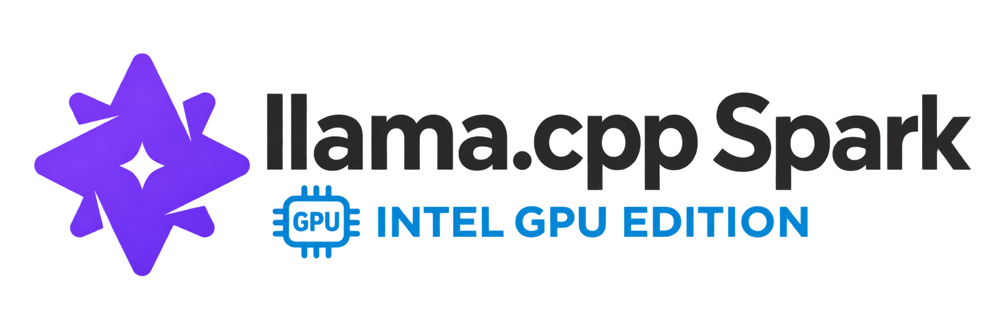

# llama.cpp Spark Intel GPU Edition

<p align="center">
  
</p>

**面向 Intel 显卡特别优化的 Vulkan / DSpark 推理版本**

基于 llama.cpp，为 **Spark-X2.6 / DSpark** 提供面向 Intel GPU 的定制推理实现。目前重点优化与验证的平台是 **Windows x64、Core Ultra 7 255H / Intel Arc 140T 集成显卡**。

本仓库同时维护推理引擎和 Windows 发布工具：设备内 DSpark、量化矩阵乘与注意力、token32 KV、HTTP 服务、固定前缀预热，以及完整的 Windows 便携发布包。主要使用方式是下载或生成完整发布包，另备配套 GGUF 模型，通过脚本直接运行。

## 本版本的主要能力

| 能力 | 本地实现与适用范围 |
| --- | --- |
| DSpark 概率推测解码 | 配套 target / draft，支持 Markov 条件链、完整词表采样及接受/拒绝验证；默认发布配置采用 D3，即每轮最多 3 个草稿 token。 |
| Vulkan 设备内 draft 路径 | Markov、draft 采样、特征处理及 token 交接使用设备路径；dense-q 简化概率表示，异步交接延后主机收集。接受/拒绝验证仍在 CPU 上执行。 |
| 小 M 量化算子 | 针对 Spark 形状优化 Q4_K、Q6_K、Q8_0、Q4_1 等矩阵乘及 M1..M8 调度，包含部分激活生产与量化融合；按形状、精度和设备能力选择路径。 |
| token32 KV | 在满足约束的 Arc 140T / Spark 单序列配置上使用 token32 K8V8 或 K4V4；SWA 和 draft 默认保留 F16。可选 F16 精度尾部。 |
| 多请求 KV 复用 | 槽位内复用共同前缀，并通过 RAM 提示缓存保存、恢复被其他请求替换的状态。 |
| 启动模板预热 | `run-server.cmd` 默认预热包内固定前缀，支持监听地址、端口、模板和换行模式配置。 |
| 便携发布 | CLI、HTTP server、bench、OpenMP DLL、启动脚本、模板、许可证及逐文件哈希统一打包。 |

当前主要验证环境是 Windows 11 x64 / Arc 140T。已使用 Spark-X2.6 1.7B 和 4B 做过设备 DSpark 验证；下文默认发布配置面向 **1.7B 主模型 + Q8 backbone draft**。其他 GPU、模型形状和后端的适用范围以对应实现文档和验证记录为准。

## 使用发布包

完整解压发布 ZIP，保留目录结构。工作区内的发布产物默认位于仓库旁的 `../dist/`；每个版本的身份、文件哈希和验证范围见该版本的 `version.json` 与 `RELEASE-REPORT.md`。

运行环境需要可用的 Vulkan 显卡驱动，以及支持 AVX2/FMA/F16C 的 Windows x64 CPU。发布包带有 `vcomp140.dll`，终端用户无需安装 Python、CMake、Visual Studio 或 Vulkan SDK。

模型另行准备：

- 主模型：`Spark-X2.6-1.7B-Q4_K_M-Q4_1.gguf`，文件名按实际产物调整。
- 配套 draft：`Spark-X2.6-1.7B-DSpark-Q8_0-backbone.gguf`。

主模型与 draft 需要匹配词表及架构，DSpark draft 还需具备对应的 Markov 权重。模型不包含在发布包中。

### 启动 HTTP 服务

以下命令在 **完整解压后的发布包根目录**用 Windows PowerShell 执行，模型路径按实际位置修改：

```powershell
.\check-vulkan.cmd

$Model = 'D:\models\Spark-X2.6-1.7B-Q4_K_M-Q4_1.gguf'
$Draft = 'D:\models\Spark-X2.6-1.7B-DSpark-Q8_0-backbone.gguf'

.\run-server.cmd -Model $Model -DraftModel $Draft -Host 0.0.0.0 -Port 8080
```

`check-vulkan.cmd` 应能枚举到 Arc 140T 对应的 `Vulkan0`。服务启动后会预热模板；看到 `Prefill complete` 和 `HTTP API ready` 再接入客户端。按 `Ctrl+C` 停止服务。

默认监听地址是 `127.0.0.1`；示例中的 `-Host 0.0.0.0` 开放 IPv4 局域网访问。`-ListenHost` 与 `-Host` 同义，也可指定某个本机 IPv4/IPv6 地址。客户端使用 `http://<服务机器 IP>:8080/v1`，模型名为 `spark-x2.6-1.7b`。

发布脚本的默认 server 配置：

| 项目 | 默认值 |
| --- | --- |
| target / draft 设备 | `Vulkan0` / `Vulkan0` |
| 上下文 / 单次输出预算 | `131072` / `131072` tokens，实际输出还受剩余上下文和 EOS 影响 |
| 并发 / CPU 线程 | 单槽位 / 12 线程 |
| Full Attention KV | token32 K8V8 |
| SWA / draft KV | F16 / F16 |
| 草稿 | D3、概率采样、`p_min=0` |
| thinking / 采样 | low；target T=1、top_p=0.95；draft T=1、top_p=1；seed=0 |
| RAM 提示缓存 | 8192 MiB，启用 idle slot 缓存 |
| 上下文检查点 | 32 个，最小间隔 8192 tokens |

`run-server.cmd` 自动设置 `GGML_VK_DISABLE_COOPMAT=1` 和三个 `LLAMA_DSPARK_*` 开关。`-ContextSize`、`-MaxTokens`、`-CacheRamMiB` 等参数可覆盖默认值；完整参数及文件校验方法见[发布包使用说明](tools/distribution/vulkan/README.zh-CN.md)。

从 Mac 或其他能访问服务的终端发送简单请求，替换示例 IP：

```bash
curl 'http://192.168.1.100:8080/v1/chat/completions' \
  -H 'Content-Type: application/json' \
  -d '{"model":"spark-x2.6-1.7b","messages":[{"role":"user","content":"你好，请介绍一下自己。"}],"cache_prompt":true,"stream":false,"max_tokens":131072,"temperature":1,"top_p":0.95,"top_k":0,"min_p":0,"seed":0}'
```

客户端显式传入的 `max_tokens` 优先于服务端默认值。此示例用于检查 API 连通性；实际业务客户端仍须发送完整的 `messages` / `tools`，才能复用其共同前缀。

### 直接生成和连续聊天

CLI 无需预先启动 HTTP 服务。它在内部启动临时本地推理服务，退出时一并关闭。先设置设备 DSpark 环境，再执行单次生成：

```powershell
$env:GGML_VK_DISABLE_COOPMAT = '1'
$env:LLAMA_DSPARK_DEVICE = '1'
$env:LLAMA_DSPARK_DENSE_Q = '1'
$env:LLAMA_DSPARK_ASYNC = '1'

$Model = 'D:\models\Spark-X2.6-1.7B-Q4_K_M-Q4_1.gguf'
$Draft = 'D:\models\Spark-X2.6-1.7B-DSpark-Q8_0-backbone.gguf'

.\run-cli.cmd -Model $Model -DraftModel $Draft `
    -KVCache q8_0 -ContextSize 131072 -MaxTokens 131072 `
    -Prompt '你好，请介绍一下自己。'
```

`-Prompt` 自动启用单轮模式，生成结束后退出。连续聊天时省略它：

```powershell
.\run-cli.cmd -Model $Model -DraftModel $Draft `
    -KVCache q8_0 -ContextSize 131072 -MaxTokens 131072
```

`/clear` 清空对话，`/exit` 退出。CLI 脚本自身仍保留 8192 上下文、512 输出和 F16 KV 默认值；上述例子显式指定了与 server 相同的容量及量化 KV。server 的启动模板预热仅用于 `run-server.cmd`。

## 固定前缀预热与缓存复用

发布包自带 `astudio_template/template.txt`。启动脚本默认将 CRLF 规范为 LF，使用服务端 `/tokenize` 将已渲染的前缀转换为 token ID，再通过 `/completion` 建立槽位 0 的 KV。该路径避免再次添加聊天模板或 BOS，并兼容引擎零预算响应中的单次预采样结果；这次采样的正文被丢弃，不追加到 KV。

```powershell
.\run-server.cmd -Model $Model -DraftModel $Draft -Host 0.0.0.0 -Port 8080 `
    -PrefillFile 'D:\inputs\my-template.txt'

.\run-server.cmd -Model $Model -DraftModel $Draft -SkipPrefill
```

`-PrefillNewlines preserve` 保留文件原换行；`-PrefillTimeoutSec` 控制启动等待和单次预热超时，默认各 1800 秒。包内模板的路径相对于脚本目录，与启动终端所在目录无关。

预热只建立前缀 KV。后续请求仍须提供完整上下文；日期、路径、工具定义、换行或消息结构变化，都可能缩短共同前缀。RAM 缓存可保存多份状态，满后淘汰旧状态，服务重启后重新预热。

命中情况可查看：

- OpenAI 风格响应：`usage.prompt_tokens_details.cached_tokens`。
- 原生 `/completion` 响应：`timings.cache_n` 和 `timings.prompt_n`。
- 处理中 `GET /slots`：`n_prompt_tokens_cache` 和 `n_prompt_tokens_processed`。

固定模板中的工作区信息保持捕获时的内容，不会随启动自动更新。发布构建者修改默认模板后，须同步其元数据中的字节数和 SHA-256。

## 从源码构建

在 Windows 的 Visual Studio 2022 x64 开发者 PowerShell 中，准备 CMake、Ninja 和 Vulkan SDK，确认 `cl`、`cmake`、`ninja` 可执行，`VULKAN_SDK` 指向 SDK 安装目录。在本仓库根目录构建开发版本：

```powershell
cmake -S . -B build-vulkan -G Ninja `
    -DCMAKE_BUILD_TYPE=Release -DCMAKE_C_COMPILER=cl -DCMAKE_CXX_COMPILER=cl `
    "-DCMAKE_PREFIX_PATH=$env:VULKAN_SDK" `
    -DGGML_VULKAN=ON -DGGML_SYCL=OFF -DGGML_OPENVINO=OFF `
    -DBUILD_SHARED_LIBS=OFF -DGGML_BACKEND_DL=OFF `
    -DCMAKE_MSVC_RUNTIME_LIBRARY=MultiThreaded -DGGML_OPENMP=ON `
    -DGGML_NATIVE=OFF -DGGML_CPU_ALL_VARIANTS=OFF `
    -DGGML_AVX2=ON -DGGML_AVX512=OFF -DGGML_AVX_VNNI=OFF `
    -DLLAMA_BUILD_TOOLS=ON -DLLAMA_BUILD_SERVER=ON -DLLAMA_BUILD_TESTS=ON `
    -DLLAMA_BUILD_EXAMPLES=OFF -DLLAMA_BUILD_APP=OFF -DLLAMA_OPENSSL=OFF `
    -DLLAMA_BUILD_UI=OFF -DLLAMA_USE_PREBUILT_UI=OFF
if ($LASTEXITCODE -ne 0) { throw 'CMake configure failed' }

cmake --build build-vulkan --parallel 2 --target `
    llama-cli llama-server llama-bench test-vulkan-vplane
if ($LASTEXITCODE -ne 0) { throw 'Build failed' }

.\build-vulkan\bin\test-vulkan-vplane.exe --contract
```

构建输出位于 `build-vulkan/bin/`。上面的 `--contract` 是 CPU 输入契约检查；真实 GPU 算子与模型验证另见对应文档。发布脚本需要与 `bin/`、模板及许可证一起组织成完整包，开发构建的输出目录与发布包目录分开管理。

## 更新版本与打包

本仓库的标准入口是 [`tools/distribution/vulkan/package.py`](tools/distribution/vulkan/package.py)，打包管理机需要 Python 3.9+ 和 `llvm-readobj`。每次更新引擎后，先冻结对应源码、构建 Windows Vulkan 运行文件并完成启动验证，再从仓库根目录打包：

```bash
python3 tools/distribution/vulkan/package.py \
  --run-dir /path/to/verified-build \
  --version 20261123-1077e592f-windows-x64-vulkan-r1
```

替换为本轮的构建目录和版本名。默认输出到仓库旁的 `../dist/<版本名>/`；当前工作区对应 `cpu_infer/dist/`。`--output-dir`、`--readobj`、`--template-dir` 可配置输出位置、LLVM PE 检查工具和默认模板资源。

打包器校验冻结源码、构建提交及选项、已验证运行文件和启动脚本、PE/DLL 依赖、模板身份、最终 ZIP 的必需文件、CRC 与逐文件 SHA-256。每个包自动携带本仓库的启动脚本与预热模板，已有版本不会被覆盖。

所需构建清单、可复用的 `build-native.cmd` 和完整流程见[打包指南](tools/distribution/vulkan/PACKAGING.zh-CN.md)。本地打包检查：

```bash
python3 -m unittest discover -s tools/distribution/vulkan -p 'test_package.py' -v
```

## 验证记录与适用边界

2026-11-20，基于 `1077e592f` 引擎及修订启动脚本，在 Ultra7 / Arc 140T 上完成了以下功能检查：

| 检查 | 结果 |
| --- | --- |
| PowerShell 5.1 启动脚本 | 23 项检查通过，含监听地址、IPv4/IPv6、换行、零预算响应和错误清理 |
| 真实模板预热 | 槽位保留 25,209 tokens |
| 完整模板加用户正文 | 输入 25,216 tokens，命中 25,209，仅新 prefill 7 tokens，正常回复并以 EOS 结束 |

2026-11-23，包含 Logo 和打包指南的打包工具通过仓库内和独立目录两次本地完整打包检查，27 个成员的 PE/DLL、模板及哈希校验通过。这些记录验证相应冻结版本的功能；后续引擎变更需使用本轮构建重新验证。

使用时还需注意以下范围：

- 设备内 DSpark 与异步交接主要覆盖单序列、target / draft 在同一 GPU 的 Spark 配置；异步交接不代表两套独立前向并发执行。
- token32 路径对模型形状、设备能力和 KV 类型有约束，详见[布局与调度说明](docs/vulkan-vplane.md)。量化 KV 有精度损失，任务质量需要单独评估。
- 算子耗时下降、短请求缓存命中和整模吞吐是不同指标。DSpark 接受率、输入长度及草稿长度会影响收益，不能用某个算子结果推算所有业务的加速比。
- 长输入 prefill 候选默认关闭，当前仍属实验配置，其验证范围与发布配置分开记录。
- 日常吞吐测量保持 profiling 关闭；CPU/GPU 时间线及算子诊断按[Perfetto 指南](docs/vulkan-perfetto.md)单独采集。

## 代码与技术说明

| 目录或文档 | 用途 |
| --- | --- |
| `common/` | DSpark 草稿、Markov 与采样流程 |
| `src/` | 模型图、上下文及 KV 状态管理 |
| `ggml/src/ggml-vulkan/` | Vulkan 算子、shader 与调度 |
| `tools/server/` | HTTP API、槽位和提示缓存 |
| `tools/distribution/vulkan/` | 发布脚本、默认模板与许可证 |
| `tests/` | 算子、DSpark、采样及缓存回归检查 |
| [DSpark Vulkan](docs/dspark-vulkan.md) / [异步交接](docs/dspark-async.md) | 设备路径、实现约束及历史验证 |
| [Vulkan 优化清单](docs/vulkan-optimizations.md) / [Q4_1 small-M](docs/vulkan-q41-small-m.md) | 量化线性算子和融合 |
| [token32 KV](docs/vulkan-vplane.md) / [F16 精度尾部](docs/vulkan-kv-precision-tail.md) | KV 格式、注意力与状态操作 |
| [CPU 优化](docs/dspark-cpu.md) | 从 CPU 分支继承的实现与适用范围 |

## 许可

本项目基于 llama.cpp 开发，保留上游及第三方版权声明，采用 [MIT License](LICENSE)。发布包携带所需的第三方许可证，模型权重遵循各自许可。
