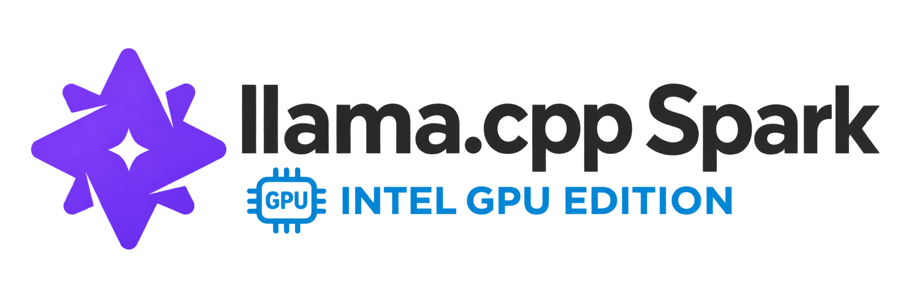

# llama.cpp Spark Intel GPU Edition - 发布打包指南

<p align="center">
  
</p>

本文面向源码仓库中的发布构建；发布包保留本指南副本，运行方法见同目录的 `README.zh-CN.md`。

此目录是本仓库的 Vulkan 打包工具源文件。每次更新引擎后，使用对应版本已构建、已验证的产物目录打包，`version.json` 记录该构建的真实源码提交。打包命令不依赖终端的当前工作目录，也不自动编译或连接测试机器。

## 常用命令

从 `llama_cpp_vulkan_opt` 仓库根目录执行，替换为本轮构建目录和新版本名：

```bash
python3 tools/distribution/vulkan/package.py \
  --run-dir /path/to/verified-build \
  --version 20261123-1077e592f-windows-x64-vulkan-r1
```

默认输出到仓库旁的 `../dist/<版本名>/`，在当前工作区即 `cpu_infer/dist/<版本名>/`。已有版本不会被覆盖。

自定义输出目录、LLVM 检查工具或模板目录：

```bash
python3 tools/distribution/vulkan/package.py \
  --run-dir /path/to/verified-build \
  --version 20261123-1077e592f-windows-x64-vulkan-r1 \
  --output-dir /path/to/dist \
  --readobj /path/to/llvm-readobj \
  --template-dir /path/to/astudio_template
```

构建者需要 Python 3.9+ 和 `llvm-readobj`。后者默认从 PATH 查找，也会复用当前工作区 `toolchain/llvm-mingw-*/bin/llvm-readobj`；独立克隆仓库时可显式传 `--readobj`。整套目录可复制到其他位置使用，启动脚本、模板、许可证和使用说明均在目录内。

## 构建输入

`--run-dir` 需要以下文件：

- `source.zip`、`source-manifest.json`：冻结源码、真实提交、逐文件字节数和 SHA-256，要求冻结时为干净源码。
- `native-runtime.zip`、`native-provenance.json`：Windows x64 Vulkan 运行文件、构建选项及哈希。
- `startup-validation.json`：通过的启动检查和已验证的运行文件、启动脚本哈希。
- `RELEASE-REPORT.md`：本轮构建与验证记录。

启动脚本会转换成 CRLF 后打包，其哈希须与本轮启动验证记录一致。更新脚本后，重新记录对应的脚本验证结果；打包器保留此检查。原生构建入口为本目录的 `build-native.cmd`，所需构建路径和源码提交通过其 `RELEASE_*` 环境变量提供。

## 每个包默认携带

- `llama-cli.exe`、`llama-server.exe`、`llama-bench.exe`、`vcomp140.dll` 和许可证。
- 本目录的 `run-server.cmd`、`run-cli.cmd`、`run.ps1`、`check-vulkan.cmd`。
- 本目录 `astudio_template/` 中的固定模板、元数据和说明；清理旧发布目录不会影响打包。
- 中文运行说明、`version.json`、`SHA256SUMS.txt`。
- 本项目 Logo 和 `PACKAGING.zh-CN.md`，名称统一为 **llama.cpp Spark Intel GPU Edition**。

HTTP server 默认在启动时预热模板，采用 128K 上下文及输出预算、8 GiB RAM KV 缓存。监听地址支持 `-Host` / `-ListenHost`、`-Port`；支持 `-PrefillFile`、`-SkipPrefill` 和 `-PrefillNewlines preserve`。LF 规范化、token ID 预热和零预算响应兼容逻辑保留在 `run.ps1` 中。终端用户只需解压包、准备模型并安装可用显卡驱动。

更换默认模板时，同步 `template-info.json` 的 `bytes` 和 `sha256`。模板中的日期、路径和工具说明是固定内容，不会随打包自动更新。Git 属性和编辑器配置会保护模板的原始字节和换行。

`astudio_template/` 已受本仓库 Git 管理，是默认模板的唯一源文件。客户端更新后，先通过服务的 `/apply-template` 渲染真实请求，去掉最后一条具体提问及回复生成标记，再用 `/tokenize` 验证模板是该请求的逐 token 前缀；相同 token 数不代表内容匹配。

当前模板截到 `</INSTRUCTIONS><environment_context>` 开头标记，排除其后的路径、日期、时区、权限等环境字段。客户端仍发送完整请求，动态环境作为尾部 prefill。截断位置须通过 token 前缀检查，避免边界处的 BPE 合并导致最后一个 token 不匹配。

## 本地检查

从仓库根目录运行：

```bash
python3 -m unittest discover -s tools/distribution/vulkan -p 'test_package.py' -v
python3 tools/distribution/vulkan/package.py --help
```

正式打包会检查源码与原生构建身份、PE 架构、DLL 依赖、模板身份，以及最终 ZIP 的必需文件、CRC、逐文件哈希和清单。缺少模板、脚本与验证记录不符或内容损坏时，不会发布版本目录。
